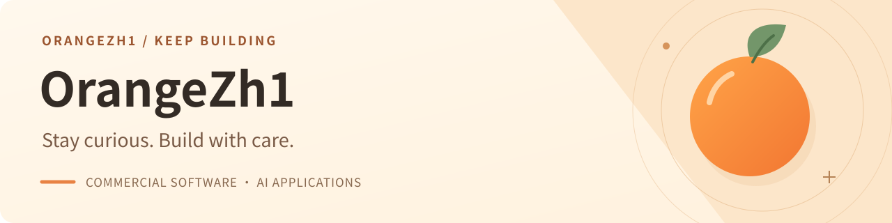

  

<h1 align="center">你好，我是橙子 OrangeZh1</h1>

  一个网络爱好者，喜欢折腾技术，目前正在努力研究 Vibe Coding。

  <a href="https://github.com/OrangeZh1?tab=repositories">项目</a>
  |
  <a href="mailto:orange@mcent.cn">邮箱</a>
  |
  <a href="https://github.com/OrangeZh1">主页</a>

---

### 关于我

- 关注网络技术、Web 开发、小程序开发和 AI 产品开发。
- 喜欢把一个想法先做成能跑的原型，再慢慢打磨成可以服务大众的软件产品。
- 这里会持续整理我的开发项目。

### 最近在做

- 二开 LikeAdmin，使框架支持多应用，并实现框架和应用分离。
- 基于 LikeAdmin 开发 Image2 创作小程序。
- 开发 QiYOrder 点餐小程序。
- 持续研究 Vibe Coding，把想法更快做成可运行的产品原型。

### 技术栈

  
  
  
  
  

### GitHub 状态

  
  

更多项目和提交记录，可以直接查看我的 <a href="https://github.com/OrangeZh1?tab=repositories">仓库列表</a>。

### 2026 目标

- 点亮一半以上的 GitHub Contributions。
- 保持稳定输出，把学习、开发和产品迭代都沉淀到仓库里。

### 一段经历

我是 2005 年出生，从小学时期开始接触互联网。最初只是出于好奇，喜欢探索各种网站、工具和新鲜的网络玩法。到了 2021 年，我开始更深入地研究技术，不再只是使用互联网，而是尝试理解它背后的逻辑，并把自己的想法一步步做成可以运行的项目。

现在的我更关注网络技术、Web 开发、小程序开发和 AI 产品开发。希望通过持续学习和实践，把一个个灵感打磨成真正能解决问题、服务大众的软件产品。

---

  感谢来访，欢迎看看我的项目。

