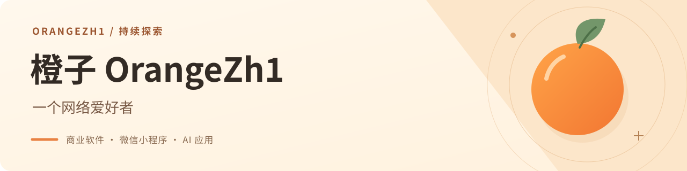

  

  <strong>👋 我是橙子 🍊</strong> 
  🎂 21 岁 &nbsp; · &nbsp; ♂ 男 
  好奇心强 · 喜欢动手 · 注重细节与体验 · 高执行力

  <a href="./README.md">English</a> &nbsp; / &nbsp; <strong>简体中文</strong>

  <a href="#qicore">🧩 QiCore-SaaS</a>
  &nbsp; · &nbsp;
  <a href="#current-work">🚀 近期项目</a>
  &nbsp; · &nbsp;
  <a href="mailto:orange@mcent.cn">✉️ 联系我</a>
  &nbsp; · &nbsp;
  <a href="https://github.com/OrangeZh1/Design-GPT-Ui-Skills">🛠️ Skills</a>

## 🧩 QiCore-SaaS · 我正在重点打磨的框架

**面向商业软件的多应用 SaaS 框架。**

QiCore-SaaS 是我想长期投入的一条主线：把通用能力统一到框架，让每个业务应用保持独立，专注自己的业务，也能持续演进。

### ✨ 核心特点

- **框架与应用分离**：业务模型、规则、路由、后台页面和客户端由应用独立维护。
- **多应用平台**：同一平台管理多个应用，每个租户绑定自己的应用。
- **通过 SDK 复用公共能力**：统一接入身份、授权、支付、存储等服务，减少重复开发。
- **统一的后台与客户端基础**：复用控制台组件，以及 H5、小程序的公共页面与能力。
- **框架与应用联合开发**：源码分别维护，支持本地联调与热更新，方便持续迭代。

### ⚙️ 技术栈

| 层级 | 使用技术 |
| --- | --- |
| 管理后台 | TypeScript · Vue · Nuxt · Nuxt UI · Tailwind CSS |
| 服务端 | Node.js · NestJS |
| 数据层 | MySQL · Redis · Prisma |
| 客户端与应用接入 | uni-app · H5 · Application SDK |

🔧 **当前重点**：持续完善 QiCore-SaaS 与开发联调体验，并基于 QiCore-SaaS 开发证件照应用。

## 🚀 其他近期项目

目前主要投入商业软件与 AI 应用开发，也会把实践中有用的开发流程整理成可复用的 Skill 分享出来。

<table>
  <tr>
    <td width="50%" valign="top">
      <h3>🔐 QiSSO</h3>
      
统一账号与单点登录服务，连接不同业务系统的身份认证与授权流程。

      统一账号 · 单点登录
    </td>
    <td width="50%" valign="top">
      <h3>🛍️ AI 电商设计应用</h3>
      
面向电商设计场景的 AI 应用，支持独立运行与框架托管。

      AI 设计 · 电商应用
    </td>
  </tr>
  <tr>
    <td width="50%" valign="top">
      <h3>🎨 Image2 创作小程序</h3>
      
AI 图片与视频创作应用，覆盖微信小程序、H5 与 PC。

      AI 创作 · 多端应用
    </td>
    <td width="50%" valign="top">
      <h3>📸 证件照小程序</h3>
      
基于 QiCore-SaaS 开发证件照应用，完善生成、下载与业务管理流程。

      证件照 · 微信小程序
    </td>
  </tr>
  <tr>
    <td width="50%" valign="top">
      <h3>🍪 校园零食优选</h3>
      
围绕校园零食场景开发小程序与管理后台，完善商品、订单和校区运营流程。

      校园电商 · 小程序
    </td>
    <td width="50%" valign="top">
      <h3>🤖 AI SCRM</h3>
      
规划智能体接待、客户线索、知识审核与业务诊断，推进产品交互和 UI 方案设计。

      智能客户运营 · 方案设计中
    </td>
  </tr>
</table>

## 🛠️ 工具与分享

### [Design GPT UI Skills ↗](https://github.com/OrangeZh1/Design-GPT-Ui-Skills)

把 UI 生图、页面分析、素材裁切与开发交付整理成可复用的 Skill。

开发工作流 · 公开分享

## 🧰 技术栈

在项目中使用和实践过的技术，也在持续学习中。

**前端与界面**

  
  
  
  
  
  
  
  

**后端开发**

  
  
  
  

**小程序与多端**

  

**数据与部署**

  
  
  
  
  

## 🌱 从好奇开始

<strong>更多关于我</strong>

嗨，我是橙子 🍊，今年 21 岁，从小学时期就开始接触互联网。各种网站、软件和新工具总能勾起我的好奇：<strong>它是怎么做出来的？我又能用它做点什么？</strong>

2021 年，我开始顺着这些好奇去学技术、写代码。后来做过博客、网站，也做过小程序。我很喜欢一个想法终于变成能点、能用的东西的那一刻，也喜欢在第一版之后，继续琢磨怎么让它更好用。

现在，我把更多精力放在<strong>商业软件和 AI 产品</strong>上。QiCore-SaaS 是我想长期打磨的一条主线，希望通过真实应用不断完善这套框架。围绕 QiSSO、电商设计、Image2、证件照、校园零食，以及正在设计的 AI SCRM，我也在一点点把不同的业务需求做成产品。

做界面时，我用过 React、Vue、Nuxt；写后端时，会接触 PHP、Node.js 和 Go；再用 MySQL、Docker、Nginx 等工具把各个部分连接起来。我喜欢带着项目学技术：遇到问题就去试、去理解，再把做过的东西慢慢打磨好。🛠️

最近也在继续探索 AI、Vibe Coding 和可复用的 Skill。一边完善 QiCore-SaaS 和手里的应用，一边希望把博客和自媒体持续做起来，分享<strong>做了什么、试过什么、在哪里卡过，以及最后学到了什么</strong>。如果你也喜欢折腾技术、做点自己的东西，欢迎来交流。👋

## 🎯 2026 目标

- **持续完善 QiCore-SaaS 框架**，打磨多应用架构、公共能力与应用接入，支撑实际商业项目。
- **持续学习 AI**，探索智能体、AI 应用与 Vibe Coding，把学到的方法用进实际项目。
- **持续做自媒体**，分享技术实践、工具心得和项目开发过程。
- **点亮一半以上的 GitHub Contributions**，保持持续学习与开发的节奏。
- **保持稳定输出**，把学习、开发和产品迭代沉淀到仓库里。

---

  🍊 保持好奇，认真做产品。欢迎交流。

